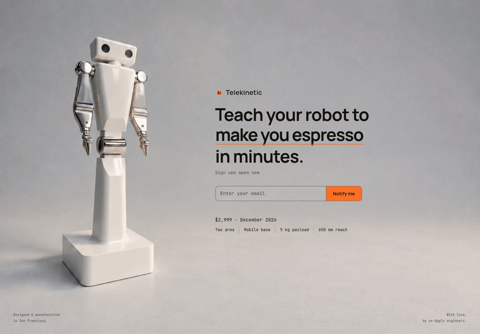
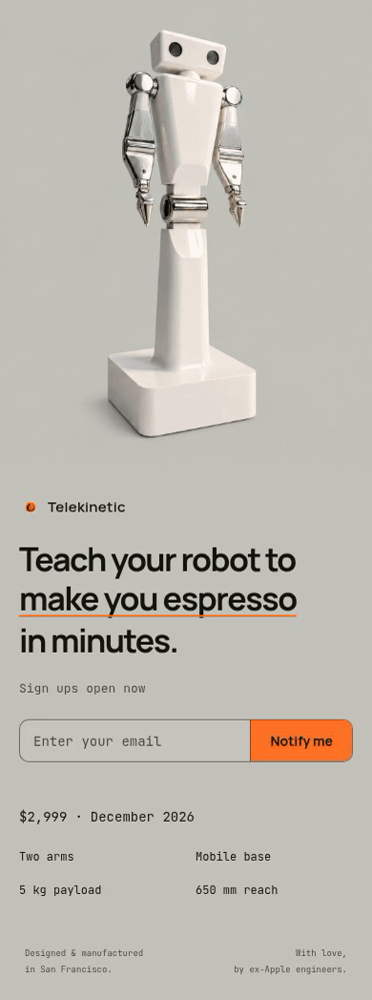
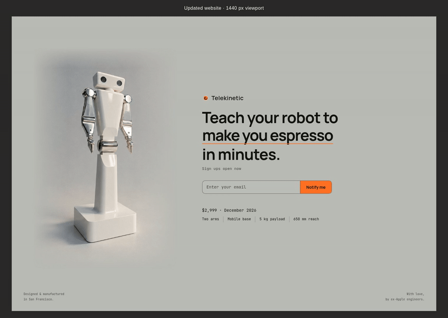

# Website previews

## Desktop

[60 fps MP4](desktop.mp4)

## Mobile

[60 fps MP4](mobile.mp4)

Each recording shows the complete 12-second headline cycle and an active logo. Each phrase has 2.35 seconds of rolling motion and a 0.65-second hold, with staggered fades to avoid overlapping text. The orange underline stays visible and vertically fixed while smoothly resizing to match each incoming phrase. Only the task text rolls. The GIFs provide inline playback in GitHub Markdown; the MP4s retain 60 fps playback.

In normal use the logo plays on hover, keyboard focus or tap, plus occasional idle cycles while visible. Reduced-motion preferences disable animation. Google requests were intercepted during recording.

## Desktop narrowing

[30 fps resize video](responsive.mp4)

The viewport moves from 1440px to 768px and back at a fixed height. The robot keeps its scale and vertical position, while the company name stays at the same height; horizontal space tightens around them. Every size uses the same extended studio photograph behind the entire page, retaining the robot’s cast shadow, lighting, and floor texture. The photo extends under the content and footer with no masks or image-panel edges. Phones pan the same scene to center the robot above the text; the layout reflows into one column at 600px.
